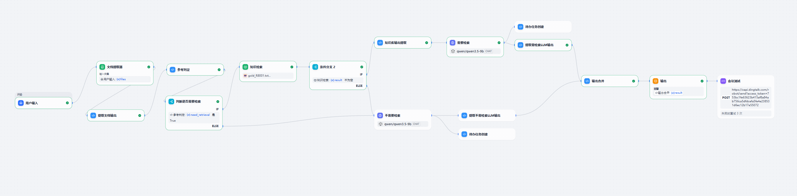
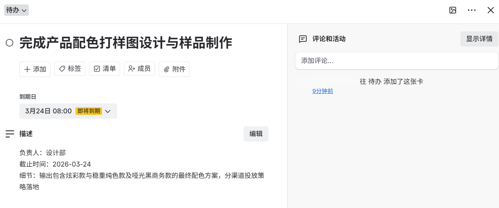
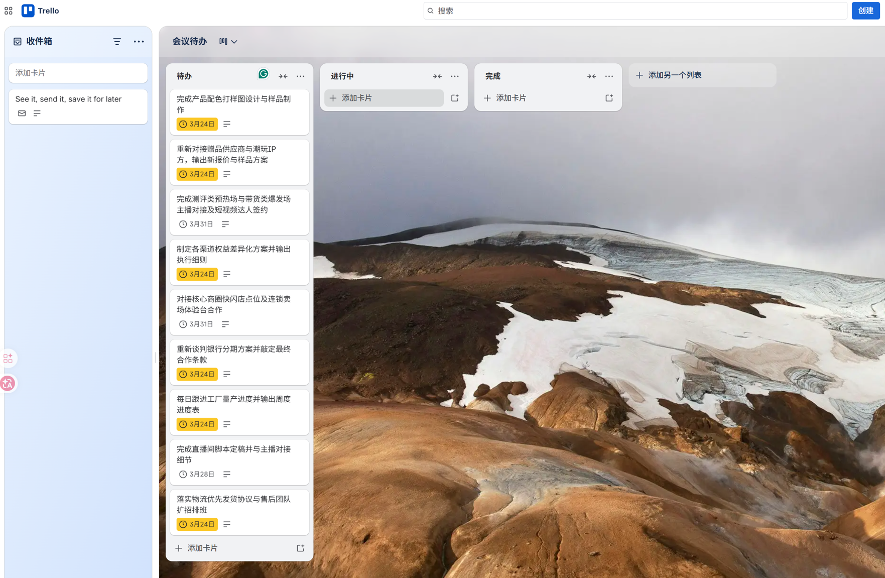
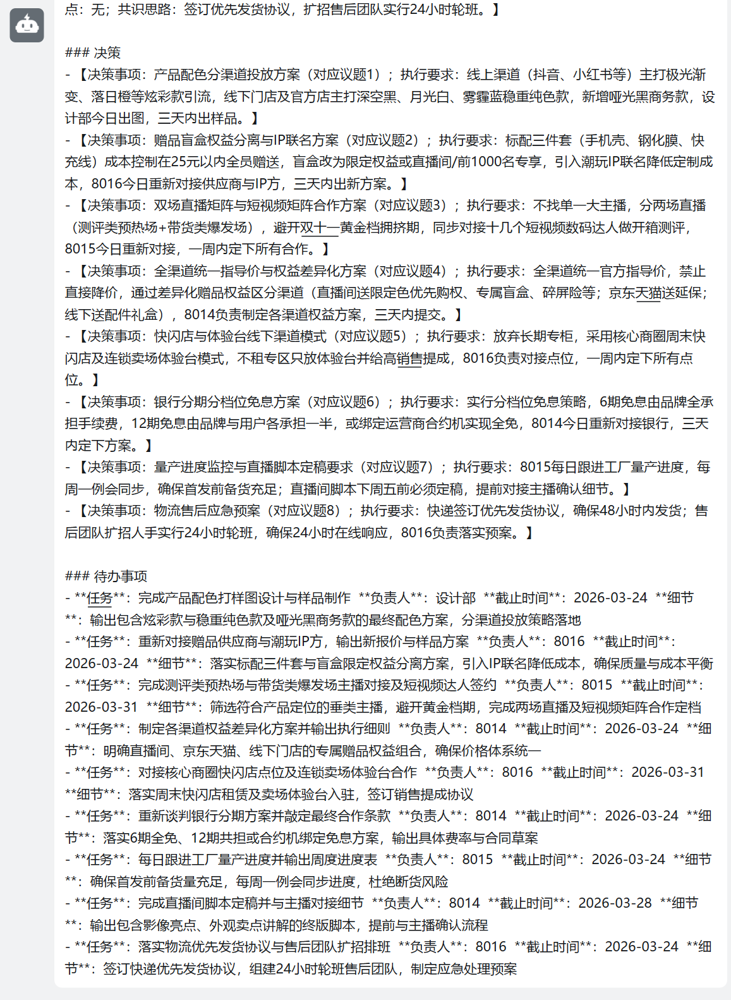

# 会议纪要助手（Dify 版）

## 一、这是干嘛的

把一场会的逐字稿文件丢进对话框，出来三样东西：一份结构化纪要（讨论点 / 决策 / 待办）、一组 Trello 卡片、一条钉钉群通知。整套流程跑在 Dify Chatflow 上，生成用本地部署的 qwen3.5-9b，向量化用 bge-m3，数据不出内网。

输入不是聊天消息，是文件——上传会议记录（JSONL 逐字稿），剩下的自动。

---

## 二、流程

```
会议逐字稿文件（sys.files）
   ↓
文档提取器 → 代码节点解析 JSONL（dialogue / meeting_id）
   ↓
文本长度校验 ──✗ 过短（< 50 字）──→ 兜底提示，不进模型
   ↓ ✓
参考判定（关键词匹配：上次 / 历史 / 参考…）
   ↓
IF1 需要检索？
   ├── 是 → 知识检索（bge-m3 · TopK=5 · 阈值 0.4）
   │         ↓
   │      IF2 召回非空？
   │         ├── 是 → 拼 context → LLM-A（挂历史纪要背景）
   │         └── 否 ────────────→ LLM-B（不挂）
   └── 否 ──────────────────────→ LLM-B（不挂）
   ↓
LLM-A / LLM-B → 各自渲染 → 输出合并 → 纪要 answer → 钉钉群机器人（Webhook）
        └────────→ 待办任务创建 → Trello 卡片（REST API）
```

A 路径挂历史纪要作为背景，B 路径不挂，其余处理一致。检索为空时自动降级到 B，不会硬答。

---

## 三、效果



待办自动落成 Trello 卡（负责人 / 截止日 / 细节都带过去）：





纪要同步推到钉钉群：



---

## 四、已知问题

1. **超长会议会截断。** qwen3.5-9b 上下文有限，目前只做了 50 字下限校验，没做上限分块——几个小时的逐字稿，模型可能只看到开头。
2. **检索 query 是整段逐字稿。** bge-m3 输入长度有限，长文做查询会被截断，历史纪要的召回质量打折。
3. **双分支代码是两份拷贝。** 需检索 / 不需检索两条路径的渲染节点和 Trello 建卡代码各存一份，改一处要记得同步另一处。
4. **Trello 建卡失败不会报错。** 单条失败只记在节点内部变量里，会话里看不出来，得去 Trello 面板上核对。

---

## 五、后续

下一版先做双分支收敛（渲染 + 建卡各留一份）和让 Trello 失败能看见，然后补一批评测用例，把纪要质量量化出来再谈迭代。

---

## License

[MIT](LICENSE) © 2026 scmz001
